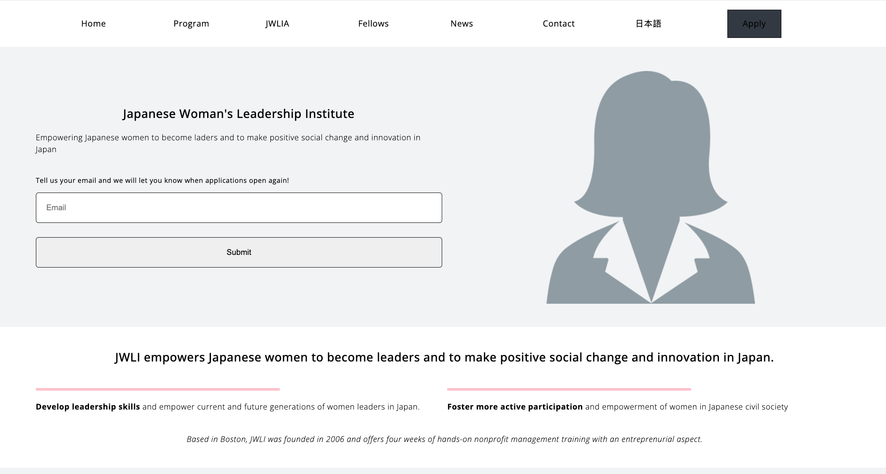

# JWLI Nonprofit Website
Responsive website developed for a Boston nonprofit, featuring layouts and an email signup form to help visitors stay connected with the organization.

# 📋 Link 
https://jwlinonprofit.netlify.app/

# 📷 Images

# ✨ Features
Fully responsive design for desktop and mobile.         

# 🔨 Built With
HTML5 – structure,    
CSS3 – responsive design and background,    
JavaScript - handling different click events. 
